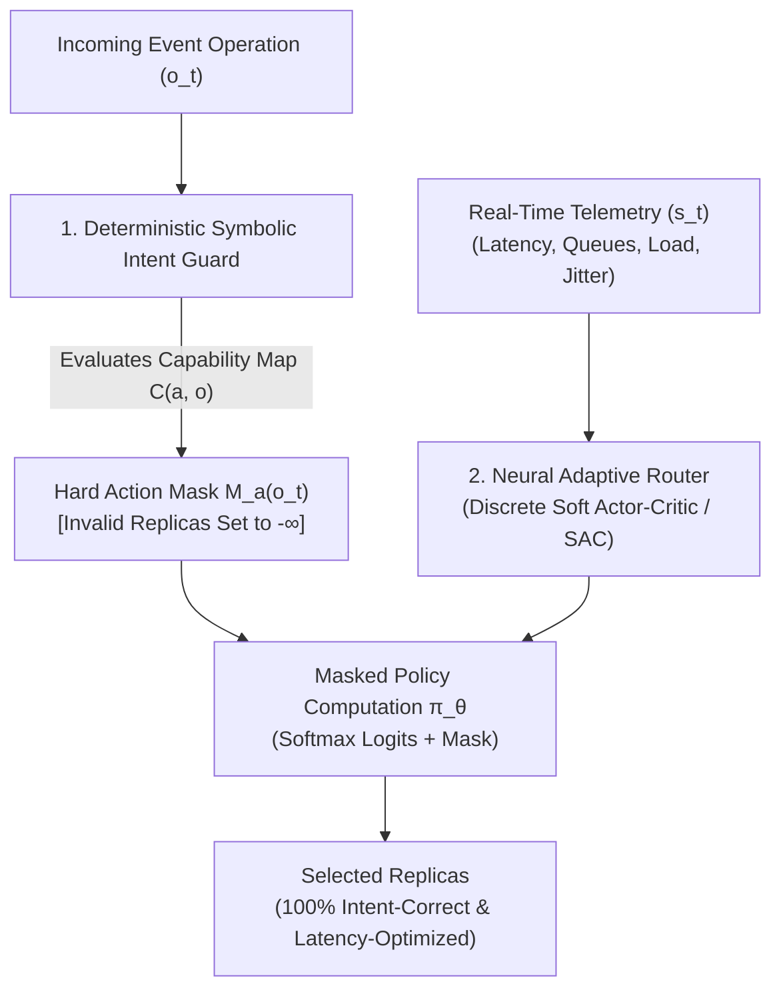

# AIAER-Mask: Master Paper Deconstruction & Study Guide
**Target Paper**: *AIAER-Mask: Safe Neuro-Symbolic Intent-Correct Routing for Event-Driven Microservices*  
**Publication**: **IEEE Transactions on Services Computing** (Volume 19, Issue 5, September/October 2026)  
**Authors**: Hossam Hassan, Shadia Sarhan, and Ahmed Shalaby  
**Length**: 11 Pages (pp. 3336–3346) | **Publisher**: IEEE  
**Local PDF Path**: [`Paper Search 2/AIAER-Mask Safe Neuro-Symbolic Intent-Correct Routing for Event-Driven Microservices.pdf`](file:///Users/krish/Desktop/Software%20Engineering/Paper%20Making/Paper%20Search%202/AIAER-Mask%20Safe%20Neuro-Symbolic%20Intent-Correct%20Routing%20for%20Event-Driven%20Microservices.pdf)  

---

## 1. Executive Summary & The Problem in Plain English

### The Core Problem in Modern Cloud Systems
In modern cloud-native systems, event-driven microservices receive thousands of concurrent operations and route them across dynamically scaling service replicas. Traditional load-balancing routers (such as Round-Robin, Exponentially Weighted Moving Average [EWMA], Power-of-Two-Choices [P2C], or unconstrained Reinforcement Learning [RL]) **only care about latency and queue length**.

* **The Fatal Flaw**: A performance-only router will happily forward a request to whichever replica has the lowest latency or shortest queue.
* **The Catastrophic Failure**: That chosen replica may be **semantically invalid** for that specific operation (e.g., routing a database update operation to a read-only replica, routing a sensitive admin call to an unauthenticated worker, or violating privacy boundaries).
* **The Trade-off Dilemma**: System throughput is preserved, but **application intent, state consistency, and data integrity are corrupted**.

---

## 2. The Solution: The Neuro-Symbolic Architecture of AIAER-Mask

AIAER-Mask solves this by creating a **strict separation of concerns** between **Safety** (what is legally allowed) and **Performance** (which allowed replica is fastest).

### Layer 1: The Symbolic Safety Layer (Deterministic & Auditable)
* Maintains an explicit, auditable **Capability Map**:
  $$C(a, o) \in \{0, 1\}$$
  where $C(a, o) = 1$ denotes that service replica $a$ is semantically authorized and capable of executing operation $o$.
* For an incoming operation $o_t$, the symbolic guard builds a **Hard Action Mask** $M_a(o_t)$:
  $$M_a(o_t) = \begin{cases} 0, & \text{if } C(a, o_t) = 1 \text{ (Admissible)} \\ -\kappa, & \text{if } C(a, o_t) = 0 \text{ (Invalid, where } \kappa \to \infty \text{)} \end{cases}$$

### Layer 2: The Neural Adaptive Layer (Performance Optimization)
* An offline-trained **Discrete Soft Actor-Critic (SAC)** reinforcement learning policy.
* Observes the dynamic telemetry state vector $s_t$ (measured latency, queue depths, load estimates, error rates).
* Produces logits $z_\theta(s_t, a)$ ranking replicas by estimated performance.
* **The Mathematical Guarantee**: When computing action probabilities via Softmax:
  $$\pi_\theta(a \mid s_t, o_t) = \frac{\exp(z_\theta(s_t, a) + M_a(o_t))}{\sum_{a' \in \mathcal{A}} \exp(z_\theta(s_t, a') + M_{a'}(o_t))}$$
* For any invalid replica where $C(a, o_t) = 0$, $M_a(o_t) = -\kappa$, meaning $\exp(z - \kappa) \approx 0$.
* **Result**: The probability of routing an operation to an illegal replica is **mathematically zero by construction**.

---

## 3. Experimental Benchmarks & Evaluation

### Benchmark Platform
The authors evaluated AIAER-Mask on **DeathStarBench**, the gold-standard cloud microservices benchmark suite developed by Cornell and used by Google, Microsoft, and Intel:
1. **SocialNetwork Workload**: Complex graph-traversal microservices with mixed read/write semantics (`compose_post`, `read_timeline`, `follow_user`).
2. **HotelReservation Workload**: Transactional, multi-tier booking services requiring strict ACID updates.

### Experimental Baselines Compared
1. **Unmasked Baselines**:
   * Static Round-Robin
   * EWMA (Exponentially Weighted Moving Average)
   * Power-of-Two-Choices (P2C)
   * Unconstrained RL (Vanilla SAC)
2. **Masked Baselines**:
   * Mask + EWMA
   * Intent-Safe P2C
   * Full AIAER-Mask (Symbolic Guard + Offline Discrete SAC)

### Key Empirical Findings
* **Intent Correctness**:
  * Unmasked baselines committed frequent, severe semantic routing errors under stress and degraded replicas.
  * **AIAER-Mask achieved 100% Intent Correctness and 0% Invalid Actions** across all workloads and failure injection tests.
* **Latency & Regret**:
  * While unconstrained routers appear faster on paper because they cheat by dumping requests onto fast but invalid replicas, AIAER-Mask delivers optimal latency **among all valid replicas**.
  * Masked heuristics (like Mask+EWMA) are exceptionally fast and low-overhead, while full AIAER-Mask excels in complex, non-linear dynamic load shifts.

---

## 4. Direct Synergy with Saphire AOCS

In your final report and viva defense, connecting this research to your own **Saphire AOCS** project demonstrates extraordinary engineering maturity:

| Concept in AIAER-Mask | Equivalent Architecture in Saphire AOCS |
|---|---|
| **Capability Map $C(a, o)$** | **Role-Based Access Control (RBAC)**: Enforcing `@PreAuthorize` guards mapping roles (`SYSTEM_ADMINISTRATOR`, `RAMP_AGENT`, `GATE_AGENT`) to specific controller endpoints. |
| **Hard Action Mask $M_a(o)$** | **Physical Aerodrome Constraints & `auth_sessions`**: Rejecting gate allocations that violate ICAO aircraft wingspan rules, and blocking requests with revoked database session tokens. |
| **Telemetry State Vector $s_t$** | **Airside Conflict & Milestone Telemetry**: Tracking runway queues, apron occupancy, and turnaround task milestones in real time. |
| **Separation of Safety & Performance** | **Layered Architecture**: Decoupling relational database consistency constraints (3NF + triggers) from front-end reactive rendering. |

---

## 5. Viva Voce Defense Cheat-Sheet (Quick Q&A)

**Q1: What is the main research problem that AIAER-Mask addresses?**  
*Answer:* Conventional cloud routers only optimize for raw latency and queue length, which causes them to route operations to fast but semantically invalid replicas. AIAER-Mask solves this by ensuring that performance optimization never violates application intent or data consistency.

**Q2: How does AIAER-Mask achieve zero invalid routing decisions?**  
*Answer:* It uses a neuro-symbolic architecture that separates safety from adaptation. A deterministic symbolic guard applies a hard action mask ($-\infty$ to invalid replicas) before the neural Soft Actor-Critic policy makes its selection, guaranteeing 100% intent correctness by construction.

**Q3: What benchmark did the authors use to evaluate the system?**  
*Answer:* They evaluated it on DeathStarBench using the SocialNetwork and HotelReservation microservice workloads under multi-replica routing, failure injection, and broker latency emulation.

**Q4: How does this research relate to your Saphire AOCS project?**  
*Answer:* It directly mirrors our AOCS safety architecture, where we use deterministic capability guards (RBAC and physical gate wingspan checks) to prevent invalid operational actions while dynamically managing real-time airport ground handling tasks.

---

*Compiled for Krishna Solanki (I075), Chaitanya Tikku (I078), Anuvrat Tripathi (I080), Anay Modi (I088)*
